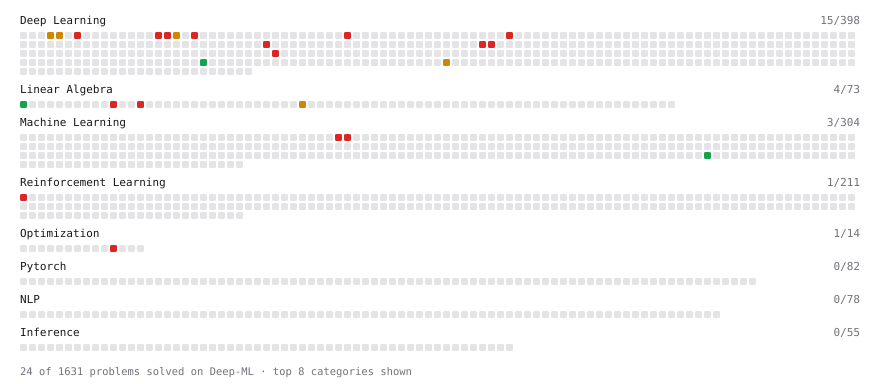

# Deep-ML

My machine learning practice from [Deep-ML](https://www.deep-ml.com). Every solution here was written by hand.

**26** solved · 23 problems · 0 labs · 3 math

[**Browse the interactive portfolio**](https://Unsone.github.io/deep-ml/) to replay this filling in over time.

## Problems

| | Difficulty | Solved | |
| --- | --- | --- | --- |
| [Balance Dataset via Undersampling](https://www.deep-ml.com/problems/1057) | easy | 2026-10-14 | [solution](problems/1057-balance-dataset-via-undersampling) |
| [Matrix-Vector Dot Product](https://www.deep-ml.com/problems/1) | easy | 2026-10-10 | [solution](problems/0001-matrix-vector-dot-product) |
| [Reparameterization Trick and the VAE Prior KL](https://www.deep-ml.com/problems/1384) | easy | 2026-10-13 | [solution](problems/1384-reparameterization-trick-and-the-vae-prior-kl) |
| [Adam Optimizer](https://www.deep-ml.com/problems/87) | medium | 2026-10-17 | [solution](problems/0087-adam-optimizer) |
| [Encoder-Decoder Cross-Attention](https://www.deep-ml.com/problems/1531) | medium | 2026-10-21 | [solution](problems/1531-encoder-decoder-cross-attention) |
| [Implementing Basic Autograd Operations](https://www.deep-ml.com/problems/26) | medium | 2026-10-11 | [solution](problems/0026-implementing-basic-autograd-operations) |
| [Single Neuron with Backpropagation](https://www.deep-ml.com/problems/25) | medium | 2026-10-16 | [solution](problems/0025-single-neuron-with-backpropagation) |
| [Solve System of Linear Equations Using Cramer's Rule](https://www.deep-ml.com/problems/119) | medium | 2026-10-15 | [solution](problems/0119-solve-system-of-linear-equations-using-cramer-s-rule) |
| [Build a Transformer Encoder Layer](https://www.deep-ml.com/problems/491) | hard | 2026-10-19 | [solution](problems/0491-build-a-transformer-encoder-layer) |
| [Flash Attention v1 - Forward Pass](https://www.deep-ml.com/problems/208) | hard | 2026-10-17 | [solution](problems/0208-flash-attention-v1-forward-pass) |
| [Implement a Simple CNN Training Function with Backpropagation](https://www.deep-ml.com/problems/130) | hard | 2026-10-18 | [solution](problems/0130-implement-a-simple-cnn-training-function-with-backpropagation) |
| [Implement a Simple RNN with Backpropagation Through Time (BPTT)](https://www.deep-ml.com/problems/62) | hard | 2026-10-10 | [solution](problems/0062-implement-a-simple-rnn-with-backpropagation-through-time-bptt) |
| [Implement Multi-Head Attention](https://www.deep-ml.com/problems/94) | hard | 2026-10-12 | [solution](problems/0094-implement-multi-head-attention) |
| [Implement Multi-Head Attention Using Einsum](https://www.deep-ml.com/problems/960) | hard | 2026-10-14 | [solution](problems/0960-implement-multi-head-attention-using-einsum) |
| [Implementing a Custom Dense Layer in Python](https://www.deep-ml.com/problems/40) | hard | 2026-10-18 | [solution](problems/0040-implementing-a-custom-dense-layer-in-python) |
| [Implementing PagedAttention: Block-wise Attention Computation](https://www.deep-ml.com/problems/492) | hard | 2026-10-14 | [solution](problems/0492-implementing-pagedattention-block-wise-attention-computation) |
| [Multi-Head Latent Attention (MLA)](https://www.deep-ml.com/problems/405) | hard | 2026-10-13 | [solution](problems/0405-multi-head-latent-attention-mla) |
| [Positional Encoding Calculator](https://www.deep-ml.com/problems/85) | hard | 2026-10-16 | [solution](problems/0085-positional-encoding-calculator) |
| [Singular Value Decomposition (SVD) of 2x2 Matrix](https://www.deep-ml.com/problems/12) | hard | 2026-10-08 | [solution](problems/0012-singular-value-decomposition-svd-of-2x2-matrix) |
| [SVD of a 2x2 Matrix](https://www.deep-ml.com/problems/28) | hard | 2026-10-10 | [solution](problems/0028-svd-of-a-2x2-matrix) |
| [Train Logistic Regression with Gradient Descent](https://www.deep-ml.com/problems/106) | hard | 2026-10-11 | [solution](problems/0106-train-logistic-regression-with-gradient-descent) |
| [Train Softmax Regression with Gradient Descent](https://www.deep-ml.com/problems/105) | hard | 2026-10-07 | [solution](problems/0105-train-softmax-regression-with-gradient-descent) |
| [Wave-Based Expert Parallelism Pipelining](https://www.deep-ml.com/problems/756) | hard | 2026-10-10 | [solution](problems/0756-wave-based-expert-parallelism-pipelining) |

## Math

| | Difficulty | Solved | |
| --- | --- | --- | --- |
| [ML Workflow Basics](https://www.deep-ml.com/math-problems/30) | easy | 2026-10-11 | [solution](math/0030-ml-workflow-basics) |
| [Backpropagation Through Movement Ops](https://www.deep-ml.com/math-problems/217) | medium | 2026-10-10 | [solution](math/0217-backpropagation-through-movement-ops) |
| [Least Squares and the Normal Equations](https://www.deep-ml.com/math-problems/34) | medium | 2026-10-11 | [solution](math/0034-least-squares-and-the-normal-equations) |

---

_This file is regenerated by Deep-ML on every push._
